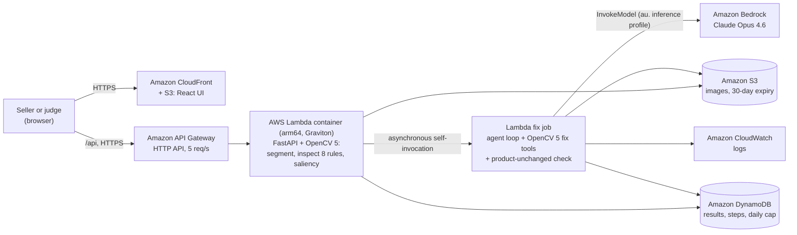
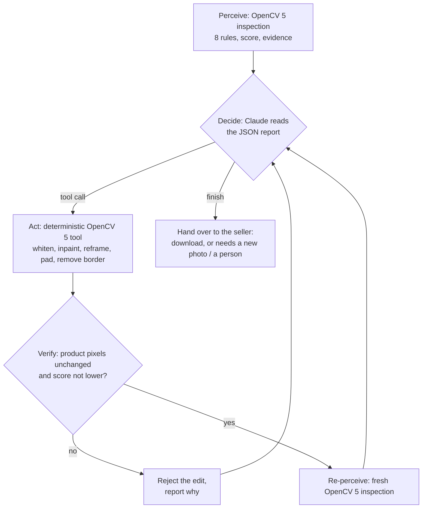

# Technical report: Listing Image Compliance Agent

OpenCV AI Competition 2026, powered by AWS · Solo entry by Balamurugan · Agentic Vision path

- Live demo: https://d2dvlco30s0p5j.cloudfront.net
- Code: https://github.com/Balu-SG/listing-image-agent
- Video: https://youtu.be/FHj6d4XUomQ
- Agent traces and failure-handling evidence: [AGENT_TRACE.md](AGENT_TRACE.md)

## 1. Problem

On Amazon the main image is the first thing a shopper sees in search, and Amazon enforces strict rules
for it (Seller Central help article G1881, "Product image requirements"): a pure white background
(RGB 255, 255, 255), the product filling 85% of the image, no added text, badges or logos, nothing cut
off, at least 500 px. A listing whose main image breaks these rules can be removed from search until a
compliant image is provided. Sellers usually find out after sales are lost, and fixing it means a
designer and a re-upload.

Existing tools either only flag problems, or "fix" them with generative image models that can quietly
change the product: its colour, its shape, the text on its packaging. For a product photo that is the
one thing that must never happen.

## 2. Users

- Small and mid-size Amazon sellers who shoot their own photos and have no designer on hand.
- Catalogue and listing teams and agencies that maintain hundreds of listings.
- Marketplace operations staff who need to know why an image fails before asking a seller to reshoot.

## 3. What the system does

1. **Perceive.** OpenCV 5 segments the product, checks 8 rules derived from Amazon's requirements and
   scores the image 0 to 100 with visual evidence.
2. **Decide.** Claude Opus 4.6 on Amazon Bedrock reads the inspection report (JSON, never pixels) and
   chooses which fix tool to call next, or decides a new photo is needed.
3. **Act.** A deterministic OpenCV tool applies the edit.
4. **Verify.** The original product pixels are mapped onto the new image and compared one by one; an
   edit that changes any product pixel, or lowers the score, is rejected and reported back.
5. **Re-perceive.** OpenCV re-inspects; the fresh report goes back to Claude and drives the next step.
6. **Hand over.** The seller downloads the fixed image, or gets a list of what needs a new photo or a
   person.

A search-visibility score (the image as a thumbnail among 8 other products, with an OpenCV saliency
heat map) shows how the image performs in a search grid.

## 4. Architecture

Agent loop (perception, decision, action):

## 5. OpenCV 5 implementation

| Stage | OpenCV 5 technique |
| --- | --- |
| Backdrop segmentation (studio photos) | Flood fill inward from the image edges in small colour steps at a fixed 1000 px working size, with low-threshold `cv2.Canny` edges as walls, so the product outline, printed labels and thin parts stay product |
| Scene detection | Backdrop colour saturation (HSV), brightness spread, and how many frame edges the subject runs off; lifestyle photos fall back to U²-Net-p via `cv2.dnn` for measuring only and are never edited |
| Text and badges (R4) | PP-OCRv3 DB detector via `cv2.dnn.TextDetectionModel_DB`; separate pieces outside the product hull that are flat-coloured rectangles with text are classed as overlays |
| Border (R5) | Line-by-line uniformity scan inward from each edge |
| Fill and framing (R2, R7) | Mask bounding box; edge contact counted only for solid (colourful or dark) pixels so reflections do not read as cut-offs |
| Sharpness (R6) | 90th-percentile absolute Laplacian on the product's Canny edges |
| Exposure (R8) | Product luminance mean and 99th percentile, ignoring filled-in holes |
| Fix tools | Masked whitening with a 3 px background-side feather, `cv2.inpaint` (Telea) on background-only text, crop/pad reframing |
| Product-unchanged check | Integer translation of the original protect mask through every crop and pad; exact per-pixel comparison |
| Search visibility | `cv2.saliency` spectral residual on a 3×3 thumbnail grid |

Rule thresholds live in `core/rulepacks/amazon.yaml`; each value is marked as Amazon's own or ours.

## 6. AWS deployment

| Service | Role |
| --- | --- |
| AWS Lambda (container image in Amazon ECR, arm64 / Graviton, 3 GB) | Inspection, agent loop, fix tools; fix jobs run asynchronously so the UI can poll each step |
| Amazon Bedrock | Claude Opus 4.6 via the `au.` cross-region inference profile in ap-southeast-2 |
| Amazon API Gateway (HTTP API) | Public API with throttling (5 req/s, burst 10) |
| Amazon S3 | Uploaded and fixed images, private, served by presigned URLs, deleted after 30 days; a second private bucket holds the web UI |
| Amazon CloudFront | Serves the UI from the private bucket through origin access control |
| Amazon DynamoDB | Results, every agent step, daily usage counters |
| Amazon CloudWatch | Lambda logs; an EventBridge warm-up rule exists, disabled by default |
| AWS Budgets | Monthly alert at USD 10 actual / USD 20 forecast |

Deployment is one AWS SAM template (`infra/template.yaml`) and a two-phase script:
`scripts/deploy.sh preview` shows the CloudFormation change set; `scripts/deploy.sh apply` deploys and
publishes the UI. Reserved concurrency (5) and a daily cap on Claude-planned fixes (200, then a
deterministic rule planner) bound cost.

## 7. Evaluation

**Product integrity.** On 60 Amazon Berkeley Objects (ABO) main images, every fix passed the
product-unchanged check (60 / 60); the average score rose from 95 to 99, and 57 of 60 reached 100.

**Rule accuracy, held-out set** (29 ABO images never used during development). Labels were made by a
blind AI visual review (Claude looking only at the images, without the inspector's output), not by a
human; this is disclosed throughout.

| Rule | Labelled | Real violations | Flagged | Caught | False alarms | Missed | Precision | Recall |
| --- | --- | --- | --- | --- | --- | --- | --- | --- |
| R1 white background | 29 | 3 | 5 | 2 | 3 | 1 | 0.40 | 0.67 |
| R2 fill 85% | 29 | 15 | 15 | 14 | 1 | 1 | 0.93 | 0.93 |
| R3 image size | 29 | 0 | 0 | 0 | 0 | 0 | n/a | n/a |
| R4 text and badges | 29 | 0 | 1 | 0 | 1 | 0 | 0.00 | n/a |
| R5 border | 29 | 0 | 0 | 0 | 0 | 0 | n/a | n/a |
| R6 sharpness | 29 | 0 | 0 | 0 | 0 | 0 | n/a | n/a |
| R7 whole product | 29 | 2 | 3 | 2 | 1 | 0 | 0.67 | 1.00 |
| R8 exposure | 29 | 0 | 0 | 0 | 0 | 0 | n/a | n/a |

**Failure cases and what they show.**
- R1 "false alarms" are mostly real but invisible: backdrops that look white but are only 74-97% exact
  RGB 255 (measured; the rest is 253). Labels made by eye cannot see this.
- An early version segmented with a salient-object model alone; it found only the bowl printed on a
  kidney-bean can, so whitening erased the can's label while the check still passed. This led to the
  edge-walled flood fill and to never editing scene photos.
- A badge that overlaps the product (a "renewed" banner across a shelf's base) merges with the product
  and is missed.
- A white product genuinely cut off at the frame edge can be missed (the price of not flagging
  reflections).

**Agent behaviour.** Real Claude runs are traced in [AGENT_TRACE.md](AGENT_TRACE.md): on the demo
image each re-inspection changes Claude's next tool choice until all rules pass (70 to 100); on a
lifestyle photo Claude makes no edits and hands the image to a person. 38 automated tests cover the
rules, the guarantee (a single changed product pixel is caught), the agent loop with a scripted Claude,
the refusal fallback and the URL-fetch safeguards.

## 8. Limitations

- Amazon's rules are quoted from its help page; the measurement thresholds are ours, not Amazon's
  internal checks. Some Amazon rules are not checked automatically: one unit only, props, mannequins,
  footwear facing left at 45 degrees, packaging, product shown once.
- Lifestyle photos are detected and refused, not repaired.
- Labels are AI-reviewed, not human; a human-labelled benchmark is the next step.
- The account's Bedrock plan allows Claude Opus 4.6; newer models need a plan upgrade.

## 9. Responsible use and security

- **Product integrity first.** No generative image editing; every pixel edit is a deterministic OpenCV
  operation on the backdrop or the frame, verified against the original product. Uncertain cases (scene
  photos, badges overlapping the product) are refused and handed to a person.
- **Honest output.** Tooltips separate Amazon's own wording from our measurement choices; the
  evaluation's labelling method and limits are stated; the agent's summary says what it could not fix.
- **Data.** No seller or customer data was used: development and evaluation use the public ABO dataset
  (CC BY 4.0). Claude receives only the inspection JSON, never images or personal data. Uploads are
  stored in a private bucket, served by short-lived presigned URLs and deleted after 30 days.
- **Abuse resistance.** API throttling, reserved concurrency, a daily cap on Claude calls, upload size
  and type checks, and image-link fetching restricted to public https addresses (private, loopback and
  metadata addresses are rejected, re-checked on every redirect).
- **Least privilege.** The Lambda role can reach only its own bucket and table, and invoke only Anthropic
  models through inference profiles on Bedrock.
- **Human control.** The agent never uploads anything to Amazon; the seller decides whether to use the
  fixed image.
- **Not affiliated with Amazon.** "Amazon" is used only to describe the marketplace rules being checked.

## 10. Reproducibility

Dependencies are pinned (`uv.lock`, `web/package-lock.json`, OpenCV `5.0.0.93`). The README gives
local run, test, evaluation and deployment commands; `scripts/fetch_models.sh` and
`scripts/fetch_abo.py` download the models and images, and `eval/run_eval.py` reproduces both
evaluation tables.
